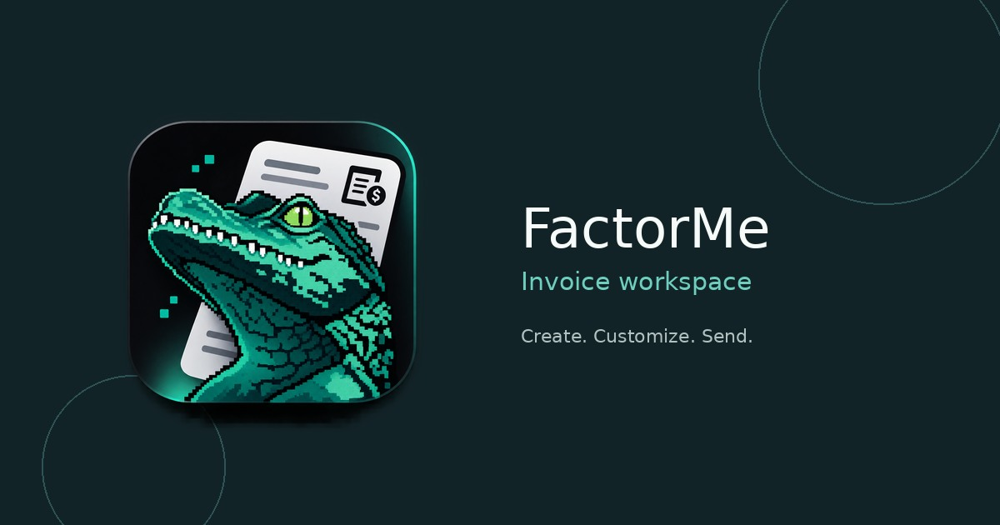
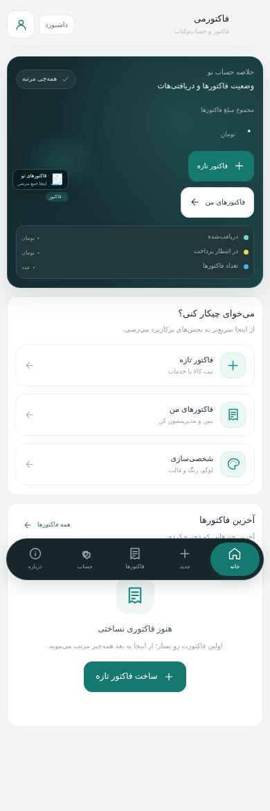
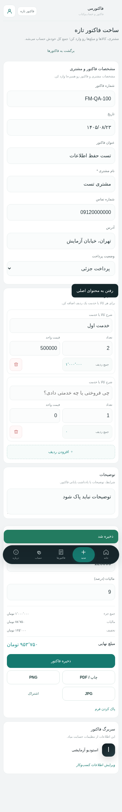
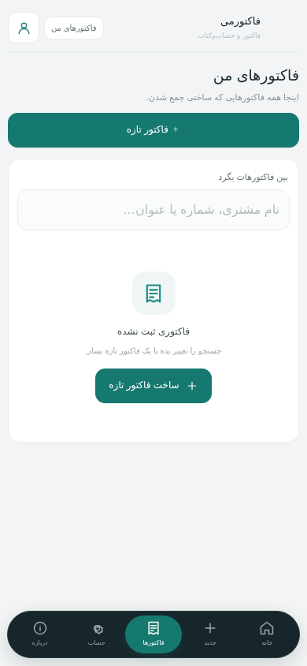
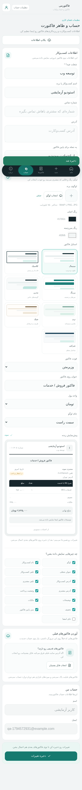
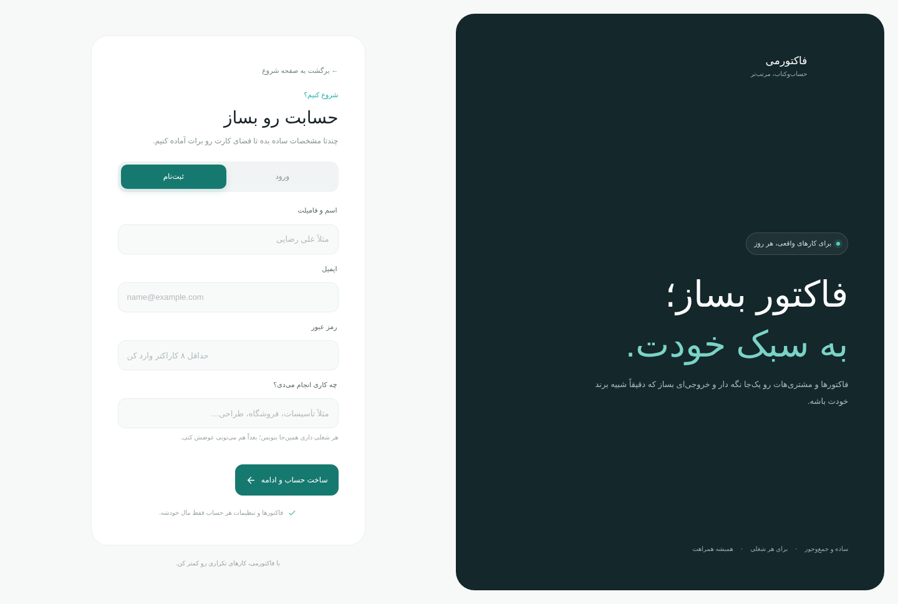
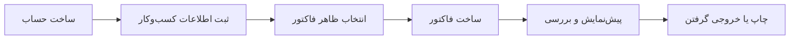

  
  <h1>فاکتورمی | FactorMe</h1>
  
<strong>یه فضای ساده و مرتب برای ساخت فاکتورهای کسب‌وکارت</strong>

  
فاکتورت رو بساز، با سلیقه خودت شخصی‌سازیش کن و راحت تحویل مشتری بده.

  

    <a href="README.md">English README</a>
    ·
    <a href="https://github.com/AmirhoseinNajafian">گیت‌هاب سازنده</a>
  

  

    
    
    
  

## فاکتورمی چیه؟

فاکتورمی یه ابزار فارسی برای ساخت و مدیریت فاکتوره؛ برای فریلنسرها، فروشگاه‌ها، خدمات فنی و کسب‌وکارهای کوچیک. می‌تونی فاکتور بسازی، ظاهرش رو با لوگو و رنگ برندت هماهنگ کنی و اطلاعات مشتری و وضعیت پرداخت رو مرتب نگه داری.

این ریپازیتوری فقط برای **معرفی و نمایش پروژه** ساخته شده. اینجا توضیحات محصول، تصاویر رابط کاربری، مستندات و فایل‌های هویت بصری قرار دارن. **کد اصلی برنامه، فایل‌های سرور، دیتابیس، اطلاعات مشتری‌ها و فایل‌های نصب داخل این مخزن نیستن.**

## امکانات اصلی

| ساخت و مدیریت فاکتور | شخصی‌سازی |
| --- | --- |
| ساخت، ویرایش، جستجو و مدیریت فاکتورها | اضافه‌کردن لوگو و اطلاعات کسب‌وکار |
| ثبت کالا یا خدمت، تعداد و قیمت | انتخاب از بین چند استایل فاکتور |
| محاسبه تخفیف، مالیات و مبلغ نهایی | انتخاب رنگ، فونت و جای لوگو |
| مشخص‌کردن وضعیت پرداخت | نمایش یا مخفی‌کردن بخش‌های فاکتور |
| چاپ و آماده‌کردن خروجی برای ارسال | دیدن پیش‌نمایش قبل از خروجی گرفتن |

داشبورد، اطلاعات مشتری، تنظیمات حساب، پشتیبان‌گیری و انتقال اطلاعات نسخه قدیمی هم بخش‌های دیگه محصول هستن.

## چند تصویر از محیط فاکتورمی

این تصاویر، پیش‌نمایش رابط فارسی و راست‌به‌چپ در اندازه موبایل هستن. اطلاعات داخل تصاویر نمونه‌ان و برای نمایش محصول استفاده شدن؛ این تصاویر به معنی فعال‌بودن سرویس عمومی یا ارائه فایل نصب نیستن.

### داشبورد

### ساخت فاکتور

### فاکتورهای من

### تنظیمات حساب و ظاهر فاکتور

### ورود و ساخت حساب

برای توضیح بیشتر، [راهنمای تصاویر](docs/SCREENSHOTS.md) رو ببین.

## برای چه شغل‌هایی؟

فاکتورمی فقط برای یه شغل خاص ساخته نشده. ایده‌اش اینه که آدم‌های مختلف بتونن باهاش کار کنن؛ مثلاً:

- خدمات فنی و کارهای ساختمونی
- فروشگاه‌ها و فروش کالا
- کارهای فریلنسری و طراحی
- مشاوره و خدمات تخصصی
- تعمیرات، نصب و پیمانکاری
- بقیه کسب‌وکارهای کوچیک

## فاکتور با ظاهر دلخواه خودت

قرار نیست فاکتور همه کسب‌وکارها شبیه هم باشه. توی فاکتورمی می‌شه لوگو، مشخصات کسب‌وکار، رنگ‌ها، فونت، سبک ظاهری و بخش‌های قابل نمایش رو تنظیم کرد. پیش‌نمایش هم کمک می‌کنه قبل از چاپ یا ارسال، نتیجه رو ببینی.

## مسیر کار با فاکتورمی

## نسخه‌های محصول

فاکتورمی در دو بسته جدا آماده شده:

- **نسخه محلی:** برای بررسی و تست محصول روی کامپیوتر.
- **نسخه هاست:** نسخه جداگانه PHP و MySQL برای محیط‌های میزبانی سازگار.

این بسته‌ها داخل این ریپازیتوری قرار ندارن و جداگانه نگهداری می‌شن. راهنمای نصب و پیش‌نیازهای هر نسخه همراه همون بسته ارائه می‌شه.

## وضعیت پروژه

فاکتورمی هنوز در حال توسعه و بهتر شدنه. این ریپازیتوری مسیر محصول و نمونه‌هایی از رابط کاربری رو معرفی می‌کنه و مخزن انتشار کد برنامه نیست. ممکنه ظاهر تصاویر با نسخه‌های بعدی تغییر کنه.

- [معرفی کامل پروژه](docs/PROJECT_OVERVIEW.md)
- [نقشه امکانات](docs/FEATURES.md)
- [جهت طراحی و هویت بصری](docs/DESIGN_DIRECTION.md)
- [نقشه راه](docs/ROADMAP.md)

## سازنده پروژه

**امیرحسین نجفیان** — طراح و توسعه‌دهنده فاکتورمی.

- گیت‌هاب: [AmirhoseinNajafian](https://github.com/AmirhoseinNajafian)
- ایمیل: [awmirhoseinnajafian@gmail.com](mailto:awmirhoseinnajafian@gmail.com)

## محدوده این ریپازیتوری و حقوق استفاده

این مخزن فقط برای معرفی و مستندسازی ساخته شده. کد اصلی برنامه اینجا نیست و انتشار عمومی این مخزن به معنی اجازه کپی، بازنشر یا استفاده تجاری از محصول، برند، ماسکات یا تصاویر نیست. قبل از استفاده از هرکدوم از این موارد، [شرایط استفاده](RIGHTS.md) رو بخون.

## ارتباط

برای سؤال یا پیشنهاد درباره فاکتورمی، از [ایمیل](mailto:awmirhoseinnajafian@gmail.com) استفاده کن.

---

  ساخته‌شده توسط <a href="https://github.com/AmirhoseinNajafian">امیرحسین نجفیان</a> · فاکتورمی

