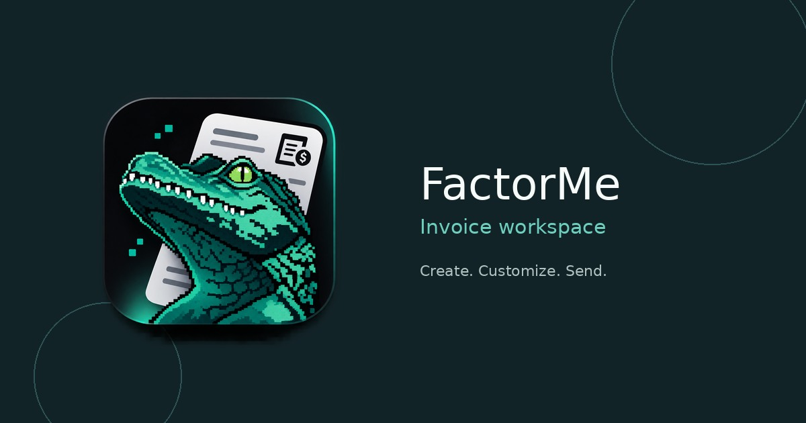
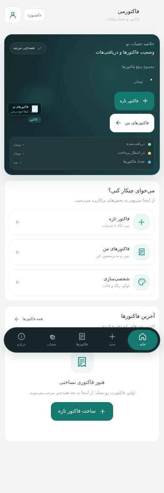
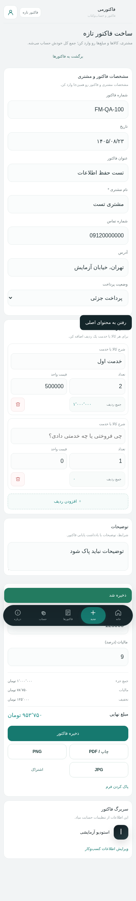
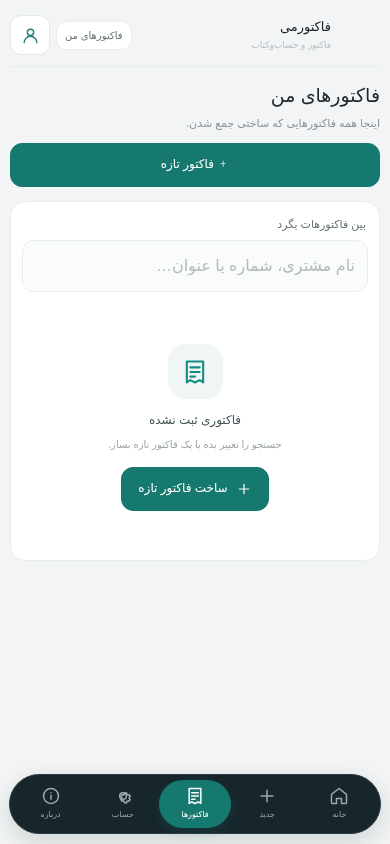
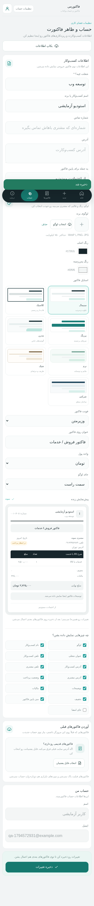
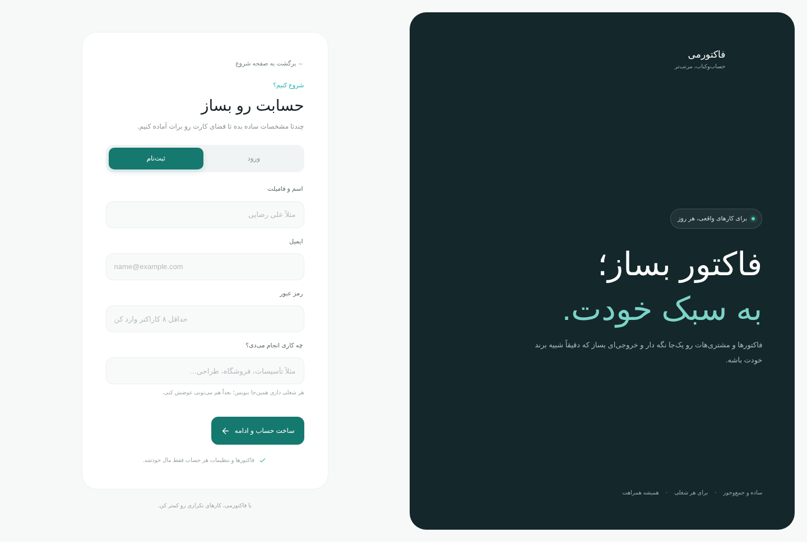
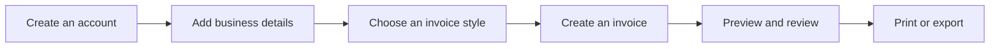

  
  <h1>FactorMe</h1>
  
<strong>A Persian-first invoice workspace for independent businesses.</strong>

  
Create invoices. Make them yours. Keep business paperwork in one place.

  

    <a href="README.fa.md">نسخه فارسی</a>
    ·
    <a href="https://github.com/AmirhoseinNajafian">Developer profile</a>
  

  

    
    
    
  

## What is FactorMe?

FactorMe is a Persian-first invoicing workspace designed to make everyday billing feel simpler. It helps freelancers, service providers, shops, and small teams prepare clear invoices, personalize the final document, and keep track of customer and payment details.

This repository is the **public product showcase** for FactorMe. It contains product information, design notes, selected interface previews, and brand assets. **The application source code, server packages, database, customer records, and deployment files are intentionally not included.**

## Product highlights

| Invoicing | Personalization |
| --- | --- |
| Create, edit, search, and manage invoices | Add a business logo and business details |
| Add service or product rows, quantities, and prices | Choose from multiple invoice styles |
| Calculate discounts, tax, and totals | Set colors, fonts, and logo placement |
| Track payment status | Show or hide selected invoice sections |
| Print and prepare shareable exports | Preview changes before producing the invoice |

Other product areas include an account dashboard, customer details, account settings, backup and legacy-data import flows.

## Interface preview

The following captures show the Persian, right-to-left interface on mobile-sized screens. They use sample interface data and are included to demonstrate the product experience—not as a live service or a downloadable build.

### Dashboard

### Create an invoice

### Invoice list

### Account and invoice settings

### Sign up and sign in

More context and notes are available in [the screenshots guide](docs/SCREENSHOTS.md).

## Made for different kinds of work

FactorMe is not tied to one trade. Its invoice fields and business profile are intended to support a range of everyday work, including:

- Technical and home services
- Retail and product sales
- Freelance and creative services
- Consulting and professional services
- Repairs, installation, and contracting
- Other small-business workflows

## Personalize the final invoice

The workspace is designed around the idea that an invoice should fit the business sending it. Users can shape the document with a logo, business information, a visual style, typography, colors, layout choices, and optional content sections. A live preview helps users review the result before printing or sharing it.

## Product flow

## Product editions

FactorMe has been prepared in two separate forms for evaluation and deployment:

- **Local preview:** a local testing edition intended for product review and QA.
- **Hosting edition:** a separate PHP and MySQL edition prepared for supported web-hosting environments.

These editions are distributed separately. They are **not** part of this showcase repository. For environment-specific requirements and installation guidance, use the documentation that accompanies the relevant package.

## Project status

FactorMe is an actively evolving product project. This repository documents the product direction and selected interface work; it is not a public source-code release. Screenshots may represent a specific development snapshot and can change as the interface evolves.

See [Project overview](docs/PROJECT_OVERVIEW.md), [Feature map](docs/FEATURES.md), [Design direction](docs/DESIGN_DIRECTION.md), and [Roadmap](docs/ROADMAP.md).

## About the maker

**Amirhosein Najafian** — product designer and developer of FactorMe.

- GitHub: [@AmirhoseinNajafian](https://github.com/AmirhoseinNajafian)
- Email: [awmirhoseinnajafian@gmail.com](mailto:awmirhoseinnajafian@gmail.com)

## Repository scope and rights

This repository is for presentation and documentation only. It does not provide the FactorMe application source or grant permission to copy, redistribute, or commercially use the product, brand, mascot, or visual assets. See [Rights and usage](RIGHTS.md) before reusing any material.

## Contact

Questions or product feedback: [awmirhoseinnajafian@gmail.com](mailto:awmirhoseinnajafian@gmail.com).

---

  Designed and built by <a href="https://github.com/AmirhoseinNajafian">Amirhosein Najafian</a> · FactorMe

